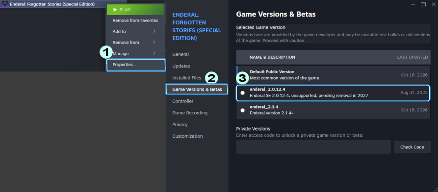

# :question: FAQ & Troubleshooting

---

## Steam Updated Enderal — Wabbajack Game Files Check Fails

**Problem:**

Steam updated Enderal, so your game files no longer match what Wabbajack expects when building the Stock Game folder. Reinstalling the game through Steam does not resolve the issue because Steam downloads the same updated files.

**Temporary Workaround:**

1. In your Steam Library, right-click **Enderal: Forgotten Stories (Special Edition)** and select **Properties...**
2. Go to **Game Versions & Betas**.
3. Select `enderal_2.0.12.4`.
4. Wait for Steam to finish downloading. Check the Downloads page to make sure the download is complete.

5. Return to Wabbajack and click **I fixed it, check again**.
6. The Game Files check should now pass. Continue the installation.

**Future Update:**

NG-EVO will be updated to support the latest Enderal version once the required SKSE mods and their dependencies have been updated and compatibility has been confirmed.

---

## :wrench: A New Life — Sirius Won't Move

Problem:
During the A New Life quest, Sirius may sometimes get stuck sitting down and won't move forward.

Fix:
1. Open the console with ~
2. Click on Sirius.
3. Type: moveto player
4. Press Enter.
5. Close the console.

Sirius should now be moved to your location and the quest can continue.

---

## :wrench: Black Light, Part II — Gates Won't Open

Problem:
During Black Light, Part II, all the gates may remain locked, preventing you from reaching Yuslan.

Fix:
1. Open the console with ~
2. Type: coc CapitalCityUpperCity00
3. Press Enter.

You should be moved directly to Yuslan, allowing the quest to continue.

---

## Game Resolution / Display Issues

Problem:
If your game resolution is incorrect or the game is not displaying correctly, you may need to change the resolution in SSE Display Tweaks.

Fix:
1. Go to: Custom Tomls ini and txts\SKSE\Plugins
2. Open: SSEDisplayTweaks.ini
3. Press ctrl+F and find resolution
4. Comment out the resolution (remove # if there is any before resolution)
5. Set the resolution to match your monitor's native resolution.
6. Save the file and launch the game again.
